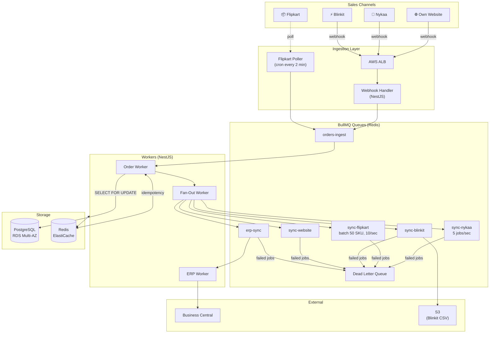

# Mars Cosmetics — Order & Inventory Sync Service
### Design Document | October 2026

**Author:** [Your Name]  
**Stack:** Node.js (NestJS), PostgreSQL, Redis, AWS  
**Team:** 3 engineers | **Timeline:** 6 weeks

---

## What problem am I solving?

Mars Cosmetics sells across 4 channels — their own website, Nykaa, Flipkart, and Blinkit — all from one central warehouse. Right now, stock levels are updated manually through spreadsheets. During a recent flash sale, 900 units were oversold because nobody updated the spreadsheet fast enough.

My job is to design a service that automatically tracks orders coming in from all 4 channels, reserves stock atomically (so two channels can't sell the same last unit), and pushes updated stock levels back out to all channels within 60 seconds. It also needs to sync everything to their ERP (Microsoft Business Central), which goes offline every Sunday for 1-2 hours of maintenance.

---

## My Approach — Keep It Simple

Before jumping into design, I want to be clear about the scale here. 8,000 orders/day is roughly 5-6 orders per minute on average. Even during flash sales (300 orders/minute = 5/sec), this is not a massive scale problem. I've seen people throw Kafka, Kubernetes, and DynamoDB at problems like this and end up with something no one can maintain. With a 3-person team and a ₹50,000/month budget, I want something boring and reliable, not impressive and fragile.

The core of the system is straightforward:
- Orders come in → go into a queue → worker processes them → stock gets reserved → all channels get updated
- Everything is async, everything has retries, and there's one source of truth for inventory (PostgreSQL)

---

## Architecture



I went with a queue-based architecture because it naturally handles the biggest problems here — rate limits, retries, and channel isolation. If Blinkit's API is having a rough day, its queue backs up but Nykaa updates keep flowing fine.

---

## Data Model

I kept the schema fairly simple. There are really only a few things I need to track: products, their stock levels, incoming orders, and an audit trail of every stock movement.

```sql
CREATE TABLE products (
    id         UUID PRIMARY KEY DEFAULT gen_random_uuid(),
    sku        VARCHAR(64) UNIQUE NOT NULL,
    name       VARCHAR(255) NOT NULL,
    created_at TIMESTAMPTZ DEFAULT NOW()
);

CREATE TABLE inventory (
    sku           VARCHAR(64) PRIMARY KEY REFERENCES products(sku),
    available_qty INTEGER NOT NULL DEFAULT 0 CHECK (available_qty >= 0),
    reserved_qty  INTEGER NOT NULL DEFAULT 0,
    updated_at    TIMESTAMPTZ DEFAULT NOW()
);

CREATE TYPE order_channel AS ENUM ('website', 'nykaa', 'flipkart', 'blinkit');
CREATE TYPE order_status  AS ENUM ('pending', 'confirmed', 'failed', 'erp_synced', 'cancelled');

CREATE TABLE orders (
    id                UUID PRIMARY KEY DEFAULT gen_random_uuid(),
    idempotency_key   VARCHAR(255) UNIQUE NOT NULL, -- "{channel}:{external_order_id}"
    channel           order_channel NOT NULL,
    external_order_id VARCHAR(255) NOT NULL,
    status            order_status NOT NULL DEFAULT 'pending',
    raw_payload       JSONB NOT NULL,
    erp_synced_at     TIMESTAMPTZ,
    created_at        TIMESTAMPTZ DEFAULT NOW()
);

CREATE TABLE order_items (
    id         UUID PRIMARY KEY DEFAULT gen_random_uuid(),
    order_id   UUID NOT NULL REFERENCES orders(id) ON DELETE CASCADE,
    sku        VARCHAR(64) NOT NULL REFERENCES products(sku),
    quantity   INTEGER NOT NULL CHECK (quantity > 0),
    unit_price NUMERIC(10,2) NOT NULL
);

-- Append-only log of every stock movement. Never update or delete rows here.
CREATE TABLE inventory_audit_log (
    id         UUID PRIMARY KEY DEFAULT gen_random_uuid(),
    sku        VARCHAR(64) NOT NULL,
    action     VARCHAR(64) NOT NULL, -- 'reserved', 'released', 'adjusted', 'erp_sync'
    delta      INTEGER NOT NULL,     -- negative = stock went down
    qty_after  INTEGER NOT NULL,
    order_id   UUID REFERENCES orders(id),
    created_at TIMESTAMPTZ DEFAULT NOW()
);

-- Flipkart poller needs to remember where it left off
CREATE TABLE poller_state (
    channel        order_channel PRIMARY KEY,
    last_polled_at TIMESTAMPTZ NOT NULL DEFAULT '1970-01-01T00:00:00Z'
);
INSERT INTO poller_state (channel) VALUES ('flipkart');
```

A couple of things worth calling out:

The `idempotency_key` column has a `UNIQUE` constraint. This means if Nykaa sends the same webhook twice (which happens regularly), the second insert just fails silently at the DB level. No extra code needed. The `CHECK (available_qty >= 0)` on inventory is my last line of defense — even if my application logic has a bug, Postgres will refuse to let stock go negative.

---

## Order Ingestion

### Webhooks (Website, Nykaa, Blinkit)

When a webhook comes in, I want to respond fast (under 200ms) because channels will retry if we're slow. So the handler does the bare minimum:

1. Verify the HMAC signature — if it's wrong, return 401 immediately
2. Extract the order ID and build the idempotency key
3. Check Redis — if we've already seen this key, return 200 and stop (it's a duplicate)
4. Enqueue the job to `orders-ingest`
5. Return 200 OK

The actual processing happens asynchronously in the Order Worker.

### Flipkart (Polling — no webhook support)

Flipkart doesn't send webhooks, so I have a cron job that runs every 2 minutes:

```typescript
@Cron('*/2 * * * *')
async pollFlipkart() {
  const { last_polled_at } = await db.query(
    `SELECT last_polled_at FROM poller_state WHERE channel = 'flipkart'`
  );

  const pollStart = new Date();
  const orders = await flipkartClient.getOrders({ since: last_polled_at });

  for (const order of orders) {
    await ordersQueue.add('ingest', {
      channel: 'flipkart',
      external_order_id: order.id,
      payload: order
    });
  }

  // Update cursor AFTER enqueueing. If we crash mid-loop, we'll re-poll
  // the same orders but idempotency handles duplicates.
  await db.query(
    `UPDATE poller_state SET last_polled_at = $1 WHERE channel = 'flipkart'`,
    [pollStart]
  );
}
```

I update the cursor AFTER enqueueing on purpose. If the process crashes partway through, we'll re-poll the same window next time — but that's fine because idempotency keys catch the duplicates.

### Order Worker

Once a job is dequeued:

1. Build idempotency key: `{channel}:{external_order_id}`
2. `INSERT INTO orders ... ON CONFLICT (idempotency_key) DO NOTHING RETURNING id` — if nothing returned, it's a duplicate, ACK and skip
3. Call the stock reservation logic
4. If stock is available → `status = 'confirmed'`, enqueue fan-out + ERP jobs
5. If stock is gone → `status = 'failed'`, ACK job (no retry needed — stock didn't change)

---

## Stock Reservation — The Critical Part

This is where overselling happens if you get it wrong. The scenario I'm designing for: Nykaa and Flipkart both try to buy the last unit of lipstick at the exact same millisecond. Only one should succeed.

I considered two options:

**Option A — Redis atomic Lua script + lock:** Decrement a Redis counter atomically, then update Postgres. Problem: now you have two systems that need to stay in sync. If Redis updates but Postgres write fails, they're out of sync. This is exactly the split-brain problem that caused the original overselling.

**Option B — PostgreSQL row-level locking (`SELECT FOR UPDATE`):** One system, one transaction, one source of truth. Atomicity is guaranteed by the database itself.

I went with Option B. Here's the logic:

```typescript
async function reserveStock(orderId: string, items: { sku: string; qty: number }[]) {
  // Sort SKUs alphabetically to avoid deadlocks.
  // If two transactions always lock rows in the same order, they can never deadlock.
  const sorted = [...items].sort((a, b) => a.sku.localeCompare(b.sku));

  return await db.transaction(async (trx) => {
    // Lock the rows. If another transaction holds a lock on these rows,
    // we wait here until it releases (i.e., commits or rolls back).
    const rows = await trx.query(
      `SELECT sku, available_qty
       FROM inventory
       WHERE sku = ANY($1::text[])
       FOR UPDATE`,
      [sorted.map(i => i.sku)]
    );

    const stock = new Map(rows.rows.map(r => [r.sku, r.available_qty]));

    // Check everything first before touching any rows
    for (const item of sorted) {
      const available = stock.get(item.sku) ?? 0;
      if (available < item.qty) {
        throw new Error(`OUT_OF_STOCK: ${item.sku} has ${available}, need ${item.qty}`);
      }
    }

    // All good — decrement
    for (const item of sorted) {
      await trx.query(
        `UPDATE inventory
         SET available_qty = available_qty - $1, updated_at = NOW()
         WHERE sku = $2`,
        [item.qty, item.sku]
      );

      await trx.query(
        `INSERT INTO inventory_audit_log (sku, action, delta, qty_after, order_id)
         SELECT $1, 'reserved', -$2, available_qty, $3
         FROM inventory WHERE sku = $1`,
        [item.sku, item.qty, orderId]
      );
    }
    // Commit → locks released. Waiting transactions can now proceed.
  });
}
```

What actually happens during the flash sale scenario:

```
T=0ms  Nykaa order arrives   → Transaction A acquires lock on SKU-LIPSTICK-RED (qty=1)
T=0ms  Flipkart order arrives → Transaction B tries to lock same row → BLOCKS
T=4ms  Transaction A: qty=1 >= 1 ✅ → decrements to 0, commits, releases lock
T=4ms  Transaction B unblocks → reads qty=0 < 1 ❌ → throws OUT_OF_STOCK, rolls back
```

The `CHECK (available_qty >= 0)` constraint is still there as a final safety net in case I have a bug somewhere.

---

## Pushing Stock Updates to Channels (Fan-Out)

Every time stock changes, I need to push updated levels to all 4 channels within 60 seconds, without hitting their rate limits.

After a successful reservation, the Fan-Out Worker reads the new quantity from the DB and creates one job per channel in their respective queues. BullMQ handles the rate limiting:

```typescript
// Nykaa: 1 SKU per call, max 5 calls/sec
const nykaaWorker = new Worker('sync-nykaa', async (job) => {
  await nykaaClient.updateStock(job.data.sku, job.data.qty);
}, {
  limiter: { max: 5, duration: 1000 }
});

// Flipkart: up to 50 SKUs per call, max 10 calls/sec
// I batch individual jobs every 5 seconds before making the API call
const flipkartWorker = new Worker('sync-flipkart', async (job) => {
  await flipkartClient.bulkUpdateStock(job.data.items); // up to 50 items
}, {
  limiter: { max: 10, duration: 1000 }
});
```

For HTTP 429 errors, instead of counting the job as a failure and retrying immediately (which makes the rate limiting worse), I move the job to a delayed state and respect the `Retry-After` header from the channel's API.

**Blinkit is a special case.** Their API has roughly 2% random timeouts, so I can't fully trust real-time REST calls alone. My approach: REST for immediate updates + a nightly cron job that generates a full inventory CSV and uploads it to S3. Blinkit ingests this CSV daily. Even if 5-10 real-time calls fail throughout the day, the CSV reconciliation at 2am resets everything to the correct state.

---

## Handling ERP Downtime (Sunday Maintenance)

Business Central goes offline every Sunday for 1-2 hours. This could mean hundreds of confirmed orders sitting unsynced. My approach: don't fight it, just queue everything.

Every confirmed order gets a job in `queue-erp-sync`. The ERP Worker tries to push it to Business Central with exponential backoff:

- Attempt 1: retry after 30 seconds  
- Attempt 2: retry after 2 minutes  
- Attempt 3: retry after 8 minutes  
- Attempt 4: retry after 32 minutes  
- Attempt 5: retry after ~2 hours  
- After 5 failures: move to DLQ, trigger CloudWatch alarm

During Sunday maintenance, jobs accumulate in Redis. The moment Business Central comes back online, workers start draining the queue automatically. No orders are lost — they just sync a bit later than usual, which the business has said they can accept.

I also include the internal `order_id` as an idempotency header on every ERP call, so retries are safe and won't create duplicate records on the ERP side.

---

## Observability

I don't need a fancy dashboard for Day 1. Five metrics will tell me if the system is healthy:

1. **Sync lag per channel** — time between `stock_changed_at` and `channel_updated_at`. Alert if p95 > 60 seconds. This is the core SLA.

2. **DLQ depth** — alert immediately if anything lands in the DLQ. Every failed job is worth looking at.

3. **Rate limit hits (429s)** — if Nykaa is getting hammered with 429s, something is wrong with my limiter config. Alert if > 10 per minute.

4. **ERP queue backlog** — if `queue-erp-sync` depth grows past 500, Business Central is probably down. Useful to know before operations starts asking questions.

5. **Order processing error rate** — failed jobs / total jobs in `orders-ingest`. Alert if > 1% over 5 minutes.

All logs are JSON with `orderId`, `channel`, `sku`, and `duration_ms` fields so I can query them in CloudWatch Logs Insights when debugging.

---

## MVP Scope — What I'm Cutting

With 3 engineers and 6 weeks, I have to be ruthless about scope. Here's what's in and what's out:

**In for v1:**
- Webhook ingestion (Website, Nykaa, Blinkit) + Flipkart polling
- Atomic stock reservation
- Fan-out to all 4 channels with rate limiting
- ERP sync with retry queue
- DLQ + basic CloudWatch alarms
- Simple admin endpoint for manual stock adjustments

**Cut for v2:**
- Returns/refund flow (warehouse team handles manually via ERP for now)
- Real-time analytics dashboard (CloudWatch logs are enough for ops)
- Multi-warehouse routing (they only have one warehouse)
- Customer notification emails (ERP already handles order confirmations)

**Rough delivery plan:**

| Week | Focus |
|------|-------|
| 1 | AWS infra (Terraform), DB schema + migrations, NestJS project setup |
| 2 | Webhook handler, Order Worker, idempotency, Flipkart poller |
| 3 | Inventory Service (FOR UPDATE), integration tests for concurrency, channel API clients |
| 4 | Fan-Out Worker + rate-limited queues, ERP sync, Blinkit CSV |
| 5 | Observability (CloudWatch), load testing with k6, hardening |
| 6 | UAT on staging, phased go-live: Website → Nykaa → Blinkit → Flipkart |

**Estimated monthly AWS cost:**

| Service | Config | Cost |
|---------|--------|------|
| RDS PostgreSQL Multi-AZ | db.t4g.medium | ~₹6,500 |
| ElastiCache Redis | cache.t4g.small | ~₹2,800 |
| ECS Fargate (2 tasks) | 0.5 vCPU, 1GB | ~₹4,200 |
| ALB + CloudWatch + S3 | — | ~₹3,500 |
| **Total** | | **~₹17,000/month** |

Well within the ₹50,000 budget. The headroom lets ECS auto-scale horizontally during flash sales based on queue depth.

---

## Trade-Offs

| Decision | What I chose | What I considered | Why |
|----------|-------------|-------------------|-----|
| Stock reservation | PostgreSQL `SELECT FOR UPDATE` | Redis Lua script + distributed lock | Redis requires dual-write between Redis and Postgres. If they get out of sync (network glitch, Redis crash), you get overselling — the exact bug I'm fixing. Postgres does it in one atomic transaction. |
| Message queue | BullMQ on Redis | AWS SQS | BullMQ gives per-consumer rate limiting, batching, delayed jobs, and a dashboard out of the box. SQS doesn't support rate limiting natively. Since Redis is already in the stack, using it for queues keeps things simple. |
| Flipkart integration | Cron poller every 2 min | Kafka / event streaming | Flipkart doesn't support webhooks — polling is the only option. And Kafka on MSK would cost ₹15-25K/month on its own, which breaks the budget. |
| ERP retry | BullMQ exponential backoff + DLQ | Saga pattern with compensating transactions | A full Saga (with rollback/compensating logic) is a 3-week build for a 3-person team. Not feasible for MVP. The queue approach is safe enough: order stays `confirmed` in our DB and eventually syncs to ERP once it's back. |
| Blinkit reliability | REST + nightly CSV | REST only | 2% timeout rate means ~1 in 50 real-time updates fails silently. Over a day of flash sales, that's meaningful drift. The nightly CSV is a simple safety net that resets everything to ground truth every 24 hours. |

---

## Assumptions I'm Making

- Channel API credentials are already available and will be stored in AWS Secrets Manager before development starts
- Flipkart's API supports timestamp-based filtering (`since` parameter). If it doesn't, cursor-based pagination using order IDs works the same way
- Business Central accepts a custom idempotency header so retries don't create duplicate ERP records
- The 300 orders/minute flash sale peak hits a small set of popular SKUs (maybe 20-50), not all 1,200 SKUs simultaneously
- Stock-in updates (receiving new inventory at the warehouse) come through ERP, which will trigger a webhook to our service to increase available_qty

---

## A Note on AI Usage

I used an AI assistant to help draft and format parts of this document. The architectural decisions — specifically the choice to use PostgreSQL row locking over Redis, the BullMQ rate-limiting approach for fan-out, the dual REST + CSV strategy for Blinkit, and the queue-based ERP retry pattern — are things I thought through and can fully explain and defend. The AI helped me structure my thinking and write it up faster. All diagrams, schema, and pseudo-code were reviewed and make sense to me technically.

---

*Mars Cosmetics — Order & Inventory Sync Design v1.0*
